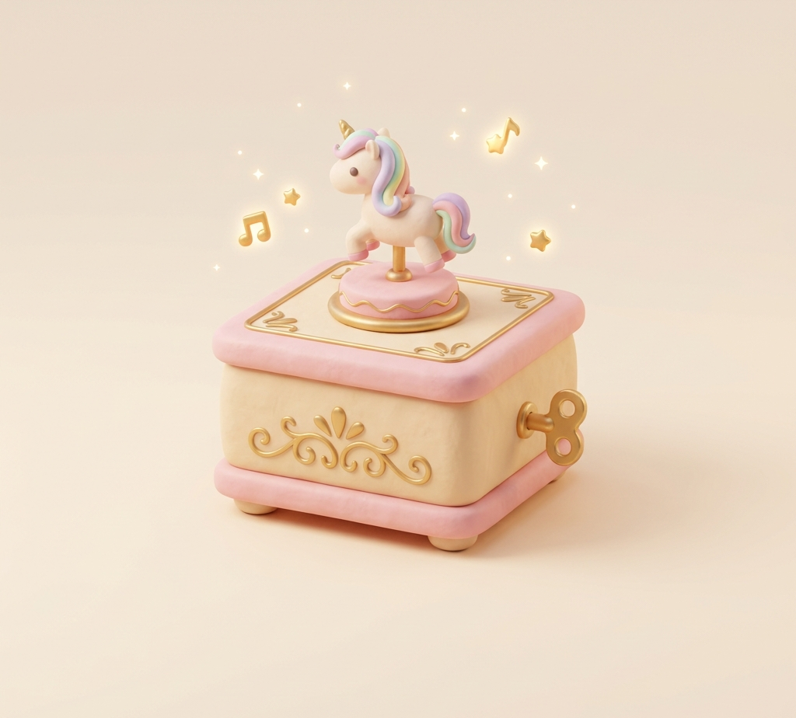
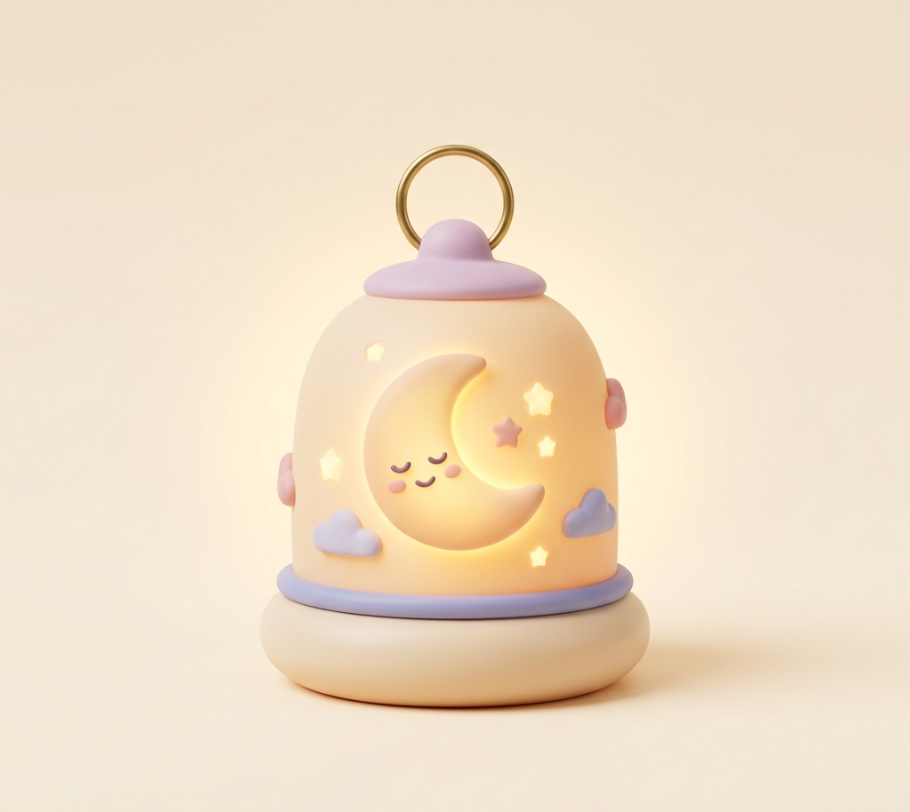

# 🌙 Pip: Junior Dream Engineer — The Midnight Nursery

<div align="center">

  

  ### 🌟 *“Crafting soothing soundscapes, soft bedside lanterns, and starlit rooftop dreamways.”*

  [](https://hax.baby)
  [](#-tech-stack)
  [](https://pip-dream-engineer.onrender.com/)

  **Built for haX.baby 2026 • 48hr Sprint • 17-19 Oct 2026 • Early Web Soul + Dreamcore Aesthetic**

</div>

---

## 📖 About Pip (Character Sheet - Track 1)

* **Name:** Pip
* **Role:** Junior Dream Engineer @ The Midnight Nursery
* **What they are:** Starry-eared baby dream engineer with moon-goggles and a glowing cloud. Hatched from a floating stardust cocoon.
* **What they do:** Crafts chime lullabies, hand-pours nightlight lanterns, navigates rooftop dream delivery routes.
* **Story:** Too tiny for day jobs but perfect for night shift. Works 2:17 AM to ensure every little dreamer sleeps peacefully.
* **Tagline:** *“Soft tunes for deep, starlit naps.”*

> Pip is © haX.baby (Original character by organizers) — Fan-made interactive portfolio.

---

## ✨ Features & Interactive Modules

### 1. 🎵 The Lullaby Lab [Tier 2 Requirement]
* Web Audio API Chime Synthesizer (C4, E4, G4, C5) — no external files
* Auto-Play Lullaby sequence + per-pad click sounds

### 2. 🕯️ Nightlight Collection
* Glow slider + hue cycler (amber, sky, rose, emerald, violet)
* Flashlight cursor — find 5 hidden stars for easter egg

### 3. 🚀 Dream Delivery Routes [Tier 2 Requirement]
* Exact `getPointAtLength()` SVG route sync — Pip glides exactly on dashed path
* Dispatch → In Transit → Delivered flow with odometer +7 dreams

### 4. ☀️ / 🌙 Day/Night + Early Web Soul
* Cream/Berry pastel palette, glassmorphic UI, VT323 + Fredoka fonts
* Chaos Mode responsive (+5), Starfield canvas, Sparkle Trail cursor

<div align="center">
    
</div>

---

## 🎯 Side Quests Completed (+11 Bonus + Extra Surprise)

| Quest | Points | Status |
| :--- | :--- | :--- |
| ✨ Sparkle Trail Cursor | +2 | ✅ Done |
| 📈 Hit Counter Odometer | +1 | ✅ Done |
| 🔊 Click Sounds + Mute Toggle | +3 | ✅ Done (Strict Requirement) |
| 🌀 Chaos Mode Responsive | +5 | ✅ Done |
| 🎁 Hidden Easter Eggs | Bonus | ✅ 2 eggs (Pip avatar x5 + Nap box x5) |


---

## 🛠️ Tech Stack

* **Frontend:** Vanilla HTML5, CSS3 (Custom Properties, Glassmorphism, 6px ink shadow)
* **Scripting:** Modern ES6+ JavaScript (No frameworks / No libs)
* **Audio:** Web Audio API — `OscillatorNode` + `GainNode` + AudioContext resume
* **Graphics:** HTML5 Canvas (Starfield + Sparkles), SVG `getTotalLength` pathing, Confetti particles

## 🎨 Credits & Attribution (Required)

* **Character:** Pip © haX.baby — Original character by haX.baby organizers
* **Art Assets:** `pip_avatar_cloud.png`, `pip_lullaby_box.png`, `pip_dream_lantern.png`, `pip_portrait.png` from Track 1 Official Asset Pack
* **Audio:** All tones generated live via Web Audio API (No external samples)
* **Fonts:** Fredoka, VT323, Space Grotesk via Google Fonts
* **Code:** 100% Vanilla JS, handcrafted — No external libraries

---

## 🚀 How to Run Locally

1.  **Clone:**
    ```bash
    **git clone** https://github.com/Sraveena1992/pip-dream-engineer.git
    cd pip-dream-engineer
   
2. **Open index.html in browser** (or use Live Server):
  npx serve .

🔗 Links
* **Live Demo**: https://pip-dream-engineer.onrender.com/
* **Repo: https**://github.com/Sraveena1992/pip-dream-engineer
* **Commit History**: Public from 17 Oct 2026 (Meets time-capsule requirement)


<div align="center">
  * Made with 💤 + ✨ for haX.baby 2026
  * Soft tunes for deep, starlit naps.
</div>


   
